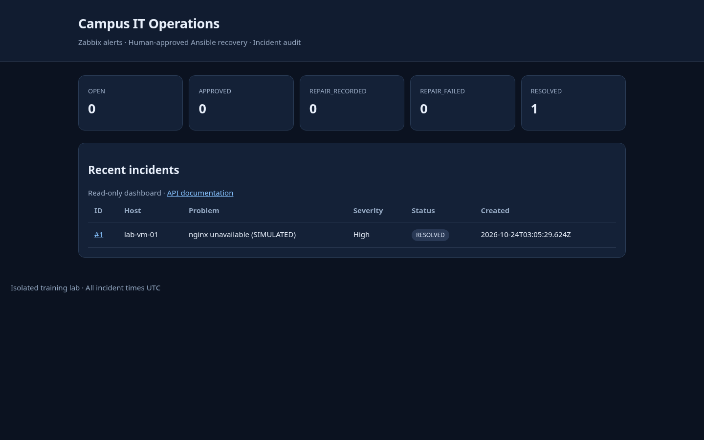
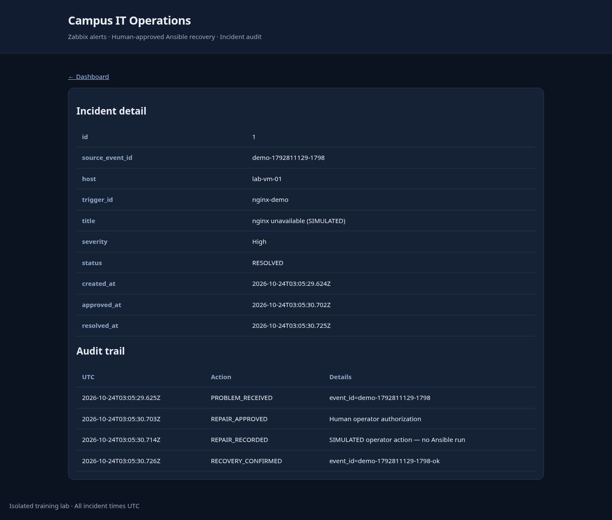

# Campus IT Operations & Auto-Recovery Platform

**Release:** v1.0.0 (isolated single-node lab; not a production campus deployment)

An original Python/FastAPI **network + operations + backend** portfolio project. Connects Zabbix monitoring with incident tracking, human-approved Ansible nginx remediation and verifiable recovery. It does **not** fork or claim authorship of Zabbix or Ansible.

> **Honest verification:** Python and JavaScript tests are automated. The simulated alert→approval→repair-record→recovery API workflow has been exercised on localhost. An actual Zabbix server, SSH target, and Docker runtime must still be tested in the user's own isolated lab. See [test report](docs/TEST_REPORT.md).

## Screenshot



Screenshot generated from a running local FastAPI application with synthetic incident records, not a claimed production deployment.

## Features

| Area | Implementation | Evidence |
| --- | --- | --- |
| Monitoring | Zabbix webhook JavaScript for `PROBLEM` and `OK` notifications | `zabbix/webhook.js`, Node tests |
| Backend | FastAPI endpoints, strict input validation, SQLite transactions | `app/main.py`, Python tests |
| Incidents | Deduplication, lifecycle, recovery correlation, pagination and filtering | `tests/test_workflow.py` |
| Identity | Separate webhook, viewer, admin tokens; Basic-auth read-only dashboard | `app/main.py` |
| Human approval | Manual authorization before Ansible and tracked repair results | `app/operator.py` |
| Safe operator tools | Fixed, allowlisted nginx playbook, inventory host checks, dry-run default | `app/operator.py`, `ansible/` |
| Dashboard | Incident counts, statuses, detail pages, escaped alert text, audit history | `/`, `/incidents/{id}` |
| Deployment | Least-privileged Dockerfile and localhost-only Compose | `Dockerfile`, `compose.yaml` |
| Tests and automation | Python, Node webhook tests, GitHub Actions, Ansible syntax in CI | `tests/`, `.github/workflows/ci.yml` |

### End-to-end demonstration

```text
Isolated lab nginx fails
      │
      ▼
Zabbix detects a trigger ──webhook──► FastAPI creates incident (OPEN)
                                         │
                                  operator approves
                                         │
                                  APPROVED incident
                                         │
                human executes allowlisted Ansible playbook locally
                                         │
                               REPAIR_RECORDED/FAILED
                                         │
                 Zabbix sends a matching OK notification
                                         │
                            RESOLVED + complete audit
```

**Safety boundary:** A webhook **never** launches Ansible. `REPAIR_RECORDED` is not the same as `RESOLVED`; only a matching monitoring recovery confirms resolution. Failed repairs require reapproval.

## Quick start (Python)

Requires Python 3.11+.

```bash
python3 -m venv .venv
source .venv/bin/activate
python -m pip install -e '.[dev]'
cp .env.example .env
```

Edit `.env` and replace all four secret placeholders with **four different random values**, each at least 24 characters. Generate each with:

```bash
python -c 'import secrets; print(secrets.token_urlsafe(36))'
```

Load local environment variables:

```bash
set -a
source .env
set +a
uvicorn app.main:app --host 127.0.0.1 --port 8000
```

Open another terminal, load `.env` again and run `bash scripts/demo-api.sh`. This is a **simulation**: no service is stopped and no Ansible is executed. Use a browser to visit `http://127.0.0.1:8000/` and sign in using `DASHBOARD_USERNAME` and `DASHBOARD_PASSWORD`. The OpenAPI UI is at `/docs` and read-only API requests need header `X-Viewer-Token`.

```bash
curl -H "X-Viewer-Token: $VIEWER_API_TOKEN" http://127.0.0.1:8000/api/v1/incidents
curl -H "X-Viewer-Token: $VIEWER_API_TOKEN" http://127.0.0.1:8000/api/v1/stats
```

## Docker Compose (local app only)

Copy and configure `.env`, then:

```bash
docker compose config
docker compose up --build -d
curl http://127.0.0.1:8000/readyz
docker compose logs --tail=100 api
```

The app binds to **127.0.0.1 only** and uses a persistent SQLite volume. Docker is optional for the Python-only demonstration; the environment where this release was assembled did not provide a Docker engine, so Compose is **not claimed as runtime-tested**. The container runs as a non-root user with read-only root filesystem and dropped capabilities. If Zabbix runs in a separate container or VM, use an explicit secure reachable network path instead of localhost.

## Tests

```bash
python -m pytest -q --cov=app --cov-report=term-missing
node scripts/test-webhook.cjs
python -m compileall -q app
```

A GitHub Actions workflow runs these checks on Python 3.11, 3.12 and 3.13, plus `ansible-playbook --syntax-check`. CI status only becomes meaningful after pushing and observing an actual green workflow run. See [TEST_REPORT](docs/TEST_REPORT.md).

## Real Linux + Zabbix + Ansible lab

Follow [LAB_SETUP.md](docs/LAB_SETUP.md) to configure a **non-production** Ubuntu VM with nginx, a reachable Zabbix server/agent and a monitoring trigger. Configure the Zabbix webhook script and its recovery operation. The media configuration must explicitly send the original problem event ID (`{EVENT.ID}`) and recovery ID (`{EVENT.RECOVERY.ID}`); recovery must not be correlated to an arbitrary active event. Check those macros in your Zabbix version.

After an incident is created:

1. Review it in the dashboard or via authenticated API.
2. Explicitly approve via `POST /api/v1/incidents/{id}/approve` with `X-Admin-Token`.
3. Place only your **owned lab server** into `ansible/inventory.ini` and list its inventory hostname in `LAB_ALLOWED_HOSTS`.
4. Dry-run the operator CLI (default):

   ```bash
   python -m app.operator --incident 1 --inventory ansible/inventory.ini
   ```

5. For an **approved, controlled lab** only, deliberately execute:

   ```bash
   python -m app.operator --incident 1 --inventory ansible/inventory.ini \
     --execute --confirm-host lab-vm-01
   ```

The CLI uses a fixed `ansible/recover-nginx.yml` and `--limit` for the approved host. It records the success/failure but never asserts that the incident is resolved until a matching Zabbix OK webhook arrives. Do not configure remote execution from a public API endpoint.

## Main project files

```text
app/                       Original FastAPI API, SQLite transactions, operator CLI
ansible/                   Fixed nginx playbook + example inventory
zabbix/                    Zabbix JavaScript webhook
scripts/                   Safe HTTP demo + webhook JavaScript tests
tests/                     API, authorization, state, concurrency, operator unit tests
docs/                      Architecture, lab setup, security, test report, roadmap
.github/workflows/          CI
.github/ISSUE_TEMPLATE/     Issue templates
Dockerfile, compose.yaml    Local container packaging
.env.example                Placeholders only (never real secrets)
```

## Limitations and intended scope

- This is a **single-process SQLite lab service**, not production high availability. For multi-instance deployment, implement a proper database, backups, migrations, a queue and production authentication.
- `HTTP Basic` should be used **only over loopback or HTTPS**. API bearer tokens are simple lab secrets, not an enterprise identity system.
- No automatic privileged recovery from a webhook; human approval and operator execution are deliberate security requirements.
- Real routing/switching/VLAN exercises are not included. Add Containerlab/FRRouting only if a verified job requirement calls for them.
- The job's detailed Chinese requirements were not retrievable from the original BOSS listing. This portfolio is aligned to the reported **network/operations/backend** role category, not a claimed 100% verified JD match.

## GitHub publishing

See [GITHUB_SETUP.md](docs/GITHUB_SETUP.md), [CONTRIBUTING.md](CONTRIBUTING.md), [SECURITY.md](SECURITY.md), [architecture](docs/ARCHITECTURE.md), [skill evidence](docs/SKILL_MAPPING.md), and [release notes](CHANGELOG.md). Capture and replace the local-demo screenshot with evidence from your own real Zabbix/Ansible lab when available.

## License / attribution

Project-specific code: MIT license ([LICENSE](LICENSE)). Upstream tools are independent projects with their own authors and licenses: [Zabbix](https://github.com/zabbix/zabbix), [Ansible](https://github.com/ansible/ansible), and [FastAPI](https://github.com/fastapi/fastapi). Their source code is **not** bundled or represented as original work.

### Incident audit screenshot (simulated local workflow)


