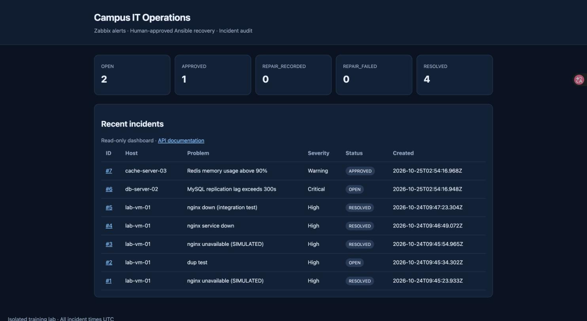
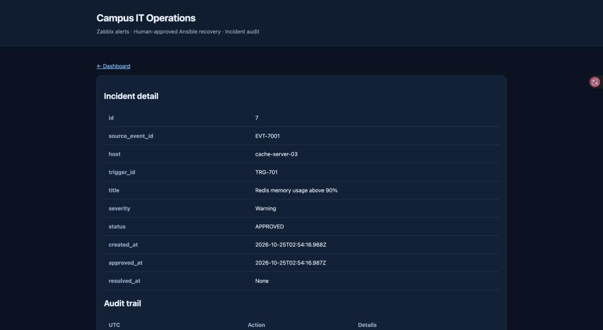

# Campus IT Operations Platform

## The Problem

A campus runs dozens of servers. When one goes down at 2 AM, someone has to notice, log in, figure out what broke, fix it, and write up what happened. This is slow, error-prone, and leaves no reliable record.

## The Solution

This platform automates the detection-to-recovery pipeline:

```
Server fails → Zabbix detects it → Incident created automatically
                                          ↓
                                   Operator approves repair
                                          ↓
                                   Ansible fixes the server
                                          ↓
                                   Zabbix confirms recovery → Incident closed
```

Every step is recorded. No repair runs without human approval. No incident closes until monitoring confirms the service is actually back.





## Tech Stack

- **Zabbix** — monitors servers and detects failures
- **FastAPI** — receives alerts, tracks incidents, serves the dashboard
- **Ansible** — runs recovery playbooks on approved hosts
- **SQLite** — stores incidents and audit trails
- **Docker** — packages everything for deployment

## Quick Start

```bash
python3 -m venv .venv && source .venv/bin/activate
pip install -e '.[dev]'
cp .env.example .env
# Edit .env — replace the four placeholder secrets with random values

set -a && source .env && set +a
uvicorn app.main:app --host 127.0.0.1 --port 8000
```

Open http://127.0.0.1:8000 for the dashboard. Run `bash scripts/demo-api.sh` to simulate a full incident cycle.

## Tests

```bash
python -m pytest -v
```

30 tests cover the full lifecycle: alert ingestion, deduplication, approval, repair, recovery, concurrency, auth, and XSS protection. CI runs on every push.

## Project Structure

```
app/           Backend API, database, operator CLI
ansible/       Recovery playbook + inventory
zabbix/        Webhook script for Zabbix
tests/         30 automated tests
docs/          Architecture, lab setup, roadmap
```

## Key Design Decisions

- **Webhooks never trigger repairs.** An alert creates an incident; a human must approve before anything runs.
- **Repair ≠ resolved.** Recording a successful Ansible run does not close the incident. Only a Zabbix OK signal does.
- **Failed repairs need re-approval.** No silent retries.
- **Four separate secrets** for webhook, viewer, admin, and dashboard — rejected at startup if weak or duplicated.

## Verified Results (Docker Integration Test)

Tested on macOS with Docker Desktop. Full incident lifecycle verified via `docker compose up` + `scripts/demo-api.sh`:

- **Incident creation** — Zabbix webhook creates OPEN incident with severity, host, description
- **Duplicate detection** — second alert for same host returns 409 Conflict
- **Approval** — operator approves incident, status transitions to APPROVED
- **Repair recording** — Ansible result recorded, status becomes REPAIR_RECORDED
- **Recovery** — Zabbix OK signal resolves incident to RESOLVED with full audit trail
- **Auth** — unauthenticated requests rejected; dashboard login enforced
- **Stats** — `/api/v1/stats` returns correct counts per status
- **Zabbix webhook JS** — 4/4 Node.js tests pass (PROBLEM/OK states, recovery event IDs, invalid state rejection)

### Limitations

- **No live Zabbix/Ansible integration.** The demo uses curl to simulate Zabbix webhooks and Ansible results. A full lab with real Zabbix monitoring a target host and Ansible executing recovery playbooks can run in containers on a single machine (Zabbix server + agent container + SSH-managed target container), with the limitation that Ansible would manage a container rather than a bare-metal host. See [Lab Setup](docs/LAB_SETUP.md).
- **SQLite only.** Suitable for a single-campus deployment; production at scale would need PostgreSQL.

## Docs

[Architecture](docs/ARCHITECTURE.md) · [Lab Setup](docs/LAB_SETUP.md) · [Test Report](docs/TEST_REPORT.md) · [Roadmap](docs/ROADMAP.md) · [Skill Mapping](docs/SKILL_MAPPING.md)

## Ownership

This project was designed and built by Yi Wang as a portfolio demonstration. The application code, tests, Ansible playbook, Zabbix webhook script, Docker configuration, and documentation are original work. It uses the following upstream software: FastAPI, SQLite, Zabbix (webhook integration only), and Ansible — each with their own licenses.

## License

[MIT](LICENSE). Zabbix, Ansible, and FastAPI are independent projects with their own licenses.
