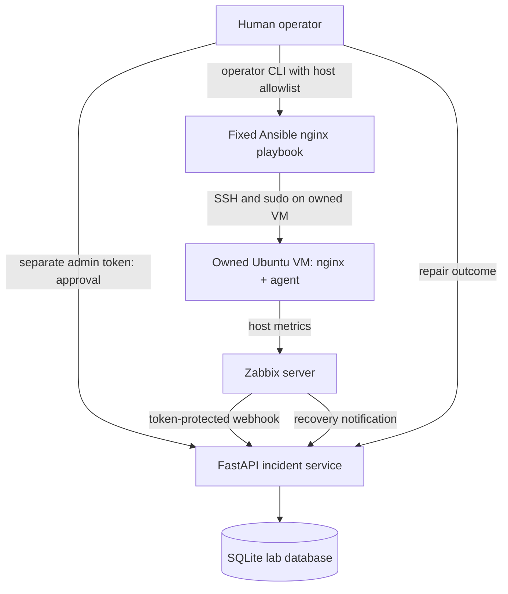
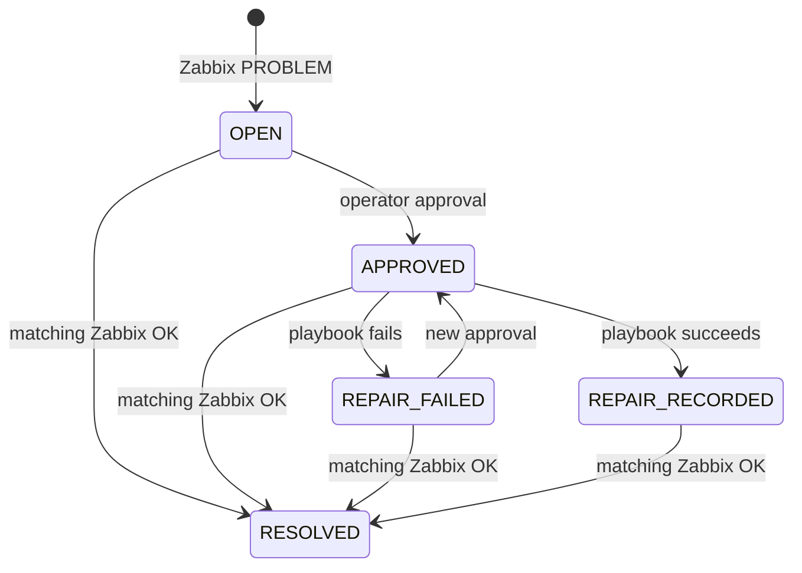

# Architecture and design decisions

## Trust boundaries

- Webhook events can **create/resolve incidents only**, never execute a command.
- Viewer reads use `X-Viewer-Token`, while browser pages use Basic auth.
- Admin approval and recording outcomes use `X-Admin-Token`, separately from the webhook secret.
- Operator CLI runs as a local deliberate action with `--execute` and exact hostname confirmation. Hostnames from events are checked with a regex and `LAB_ALLOWED_HOSTS`; dynamic shell execution is not used.
- Ansible targets require a prepared local inventory and admin-controlled SSH/sudo access.

## Incident state machine

A recovery has priority over approval/repair when confirmed by monitoring (for example, a service restarts itself). Resolution must correlate by original `problem_event_id` + hostname + trigger whenever available. Without a problem ID, fallback is allowed only if **exactly one** unresolved incident matches the host and trigger. Ambiguous recoveries return HTTP 409 to avoid silently closing the wrong incident.

## Storage

The database contains `incidents`, append-only `audit_events` and `recovery_events` (for idempotent recovery deliveries). SQLite `BEGIN IMMEDIATE` serializes write transactions, ensuring the same problem event ID creates a single incident even with concurrent webhooks. Read endpoints have bounded page sizes. The database is not claimed to withstand multiple distributed writers or long-term production audit requirements.

## Threat model (short)

- **Spoofed alert:** webhook token rejects it. Network-level protections are still recommended.
- **Unauthorized repair:** admin credential gate + separate local operator CLI + host allowlist.
- **Duplicate notifications:** unique problem IDs and recovery-event receipts prevent repeat transitions.
- **Ambiguous recovery:** reject rather than incorrectly closing the incident.
- **XSS in event title:** dashboard escapes untrusted text.
- **Secret leak:** no real `.env`, inventory or SSH credentials in Git; tokens never returned by API.
- **Network reachability:** Compose listens on localhost; do not expose without reverse proxy TLS/auth/rate limits.

See [SECURITY.md](../SECURITY.md) for limitations.
